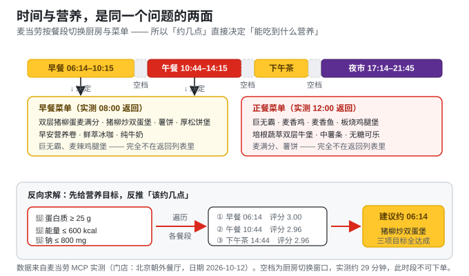
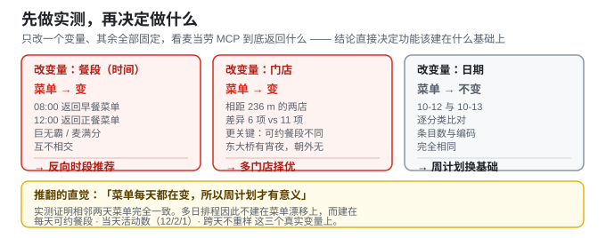
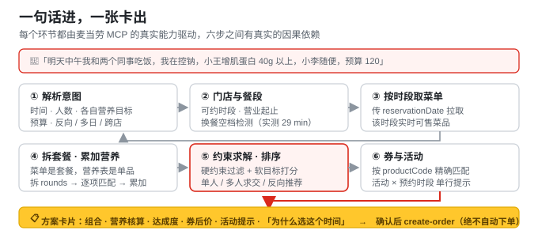

# 🍔 mcd-nutrition-booking · 麦麦营养预约规划师

> **在正确的时间，为正确的人，预约一份「刚刚好、更划算」的餐。**
>
> 按时段求解营养目标 → 自动匹配当前订单可用券 → 提示预约时段内正在进行的活动

[](https://github.com/github-zzj2019/mcd-nutrition-booking/stargazers)
[](https://github.com/M-China-Official/mcd-developer-innovation-challenge)
[](https://www.workbuddy.cn)

一个基于 **麦当劳 MCP** 能力的 [WorkBuddy](https://www.workbuddy.cn) Skill。输入一句自然语言（时间、人数、各自的营养目标、预算），输出一份可直接确认下单的**预约方案卡片**——包含推荐组合、营养核算、达成度评分、券后价格、活动提示，以及「为什么选这个时间」的解释。

---

## ✨ 为什么它不是又一个「营养查询工具」

麦当劳的菜单**不是全天一致的**——早餐（麦满分/厚松饼堡/早安营养卷）与正餐（巨无霸/麦辣鸡腿堡/板烧鸡腿堡）分属不同餐段，由厨房设备切换决定。于是「时间」和「营养」构成了**双向约束**：

```
正向：预约时间 → 决定可点餐段菜单 → 决定营养可行域
反向：营养目标 → 反推最优餐段 → 推荐预约时间
```

这已通过 MCP 实测证实：`query-meals` 传 `reservationDate=2026-10-12 08:00` 时，返回的是**早餐菜单**，巨无霸等正餐产品**完全不在返回列表中**。



### 实测数据支撑的真实权衡

| 餐品 | kcal | 蛋白 | 钠 |
|---|---|---|---|
| 巨无霸（正餐） | 513 | 27g | 961mg |
| 双层猪柳蛋麦满分（早餐） | 513 | **29g** | 1210mg |

同样是 513 kcal：早餐蛋白更高，但钠也更高。

- 要「**高蛋白 + 控卡**」→ 约**早餐**更合适
- 要「**高蛋白 + 控钠**」→ 约**午餐**更合适

**普通人不可能自己算出这个权衡**——这就是这个 Skill 存在的意义。

> 🐟 顺带一个官方数据彩蛋：麦当劳营养接口自带的 `nutritionDescription` 字段写着
> **「芝士安格斯厚牛堡 696 kcal ≈ 能量约鲈鱼 1 条」**（另有「柠檬拉明顿 121 kcal ≈ 猕猴桃 2 个」）。
> 这类生活化类比来自官方接口，本项目直接透传展示，不做二次加工。

---

## 🚀 杀手功能

1. **反向时段推荐**（最锋利）——给营养目标，反推「该约几点」。这是纯推荐类作品做不出来的，因为它必须同时理解菜单、餐段和营养约束。
2. **多人目标求交**——一单满足多人不同目标（如「我控钠、小王增肌、小李随便」），做整单多目标核算。
3. **替换优化**——基于 `query-meal-detail` 的可替换项微调（中薯条 → 小杯玉米杯、可乐 → 无糖可乐）。
4. **券与活动联动**——按 `productCode` 把已校验可用的券匹配到方案上，并提示预约时段内正在进行的活动。

---

## 🔬 进阶功能：把「时间」这条约束用到底

四个进阶能力同样全部来自实测，而且各自都推翻或坐实了一个直觉假设。



它们不是四个孤立的脚本：`scripts/run_scenario.py` 是**唯一入口**，按意图自动路由，并在恰当的时刻自动附加其中两项。

| 触发条件 | 模式 | 调用 |
|---|---|---|
| 出现「连续三天 / 这周」 | 多日排程 | `plan_week.py` |
| 出现「哪家店 / 换个店」+ 明确时间 | 跨店择优 | `compare_stores.py` |
| 出现「哪家店 / 换个店」但**没有**时间 | 先反推时段 | `recommend_slot.py` |
| 出现「约几点合适」或只给目标 | 反向时段推荐 | `recommend_slot.py` |
| 预约日期是**今天** | **自动**附加紧迫度 | `time_guard.py` |
| **没有任何方案完全达标** | **自动**附加诊断 | `diagnose.py` |

> 路由时 `planMode`（意图）优先于 `timeStatus`（时间）。多日请求本来就没有单一时间点，若按时间状态判断，会被错误地塞进「反向时段推荐」。

### ① 多门店择优——「门店」本身就是一个时间约束

相距仅 **236 m** 的朝外店与东大桥店，同一日期、同一时段返回**不同的菜单**，更关键的是**可预约餐段不同**：东大桥有「宵夜(22:14–22:46)」，朝外没有。

于是「晚上 22:30 想约一顿」在最近的店**无解**，走一个街区才有解：

| 门店 | 距离 | 22:30 是否可约 | 原因 |
|---|---|---|---|
| 麦当劳北京东大桥餐厅 | 462 m | ✅ 宵夜(22:14–22:46) | 有宵夜餐段 |
| 麦当劳北京朝外餐厅 | **226 m** | ❌ | 该店最晚到 21:45 |

把时间往前挪 30 分钟，**结论完全翻转**——早一点反而一家都约不到：

| 时间 | 朝外（226 m） | 东大桥（462 m） |
|---|---|---|
| **22:00** | ❌ 已过营业（最晚 21:45） | ❌ 落在换餐空档 21:45→22:14 |
| **22:30** | ❌ 已过营业 | ✅ 宵夜可约 |

全部门店都不可约时，工具不会只说「不行」——它从门店预约时段里算出**下一个可约时刻**并给出「改约到 **22:14** 即可」（这一结论无需额外查询接口）。

菜单也有真实差异，且差异项恰好被官方营养表精确收录：东大桥独有「脆脆薯条」，朝外独有「抹茶/咖啡阿芙佳朵」「浓缩咖啡」。所以「附近哪家店还能点到 X」是一个真问题。

> 诚实说明：同商圈门店菜单重合度约 95%，宽松目标下各家最优餐品通常相同。门店择优的真实价值在**该时间哪家可约**与**某款餐品哪家还有**，这一点代码和文案里都写明了，不夸大。

### ② 时间紧迫度——「今天」和「明天」的可约餐段并不一样

实测发现：**接口不会返回已经结束的餐段**——今天（12:39）的返回列表里直接不含早餐。所以「今天约不到早餐了」这件事，只看今天的返回是看不出来的，必须与另一天做差集才能发现：

| 日期 | 可预约餐段 |
|---|---|
| 2026-10-11（今天 12:39） | 午餐、下午茶、夜市 |
| 2026-10-12（明天） | **早餐**、午餐、下午茶、夜市 |

用户说「现在想吃个麦满分」，必须被告知：**今天已经约不到早餐，明天 06:14 起才可以。**

### ③ 多日排程——先推翻一个直觉

直觉是「菜单每天都在变，所以周计划才有意义」。**实测推翻了它**：同一门店 2026-10-12 与 2026-10-13 的午餐菜单**完全一致**（逐分类比对，条目数与编码均相同）。

所以周计划不建在菜单漂移上，而建在三个真实变量上：**每天的可约餐段**、**当天的活动数**（实测连续三天为 12 / 2 / 1 个）、**跨天不重样本身**。

| 日期 | 推荐组合 | 能量 | 蛋白 | 钠 | 价格 | 当天活动 | 重样 |
|---|---|---|---|---|---|---|---|
| 10-12 | 麦香鸡 | 369 kcal | 15 g | 731 mg | ¥17 | 2 个 | 否 |
| 10-13 | 麦香鱼 | 325 kcal | 16 g | 556 mg | ¥23 | 1 个 | 否 |
| 10-14 | 培根蔬萃双层牛堡 | 442 kcal | 24 g | 728 mg | ¥25 | 0 个 | 否 |

三天三款不重样、每天钠都 ≤ 800 mg。注意「钠 ≤ 800 mg」在麦当劳是相当紧的约束，可行域只有三项——**窄到刚好够排三天**。

### ④ 无解诊断——「没有找到方案」不是答案

诊断的触发条件是「**没有任何方案完全达标**」，而不只是「一个方案都没有」。后者很少见；真正常见的是卡片上列着三个方案、最好的那个却只有 90%——看起来一切正常，用户完全不知道自己的目标其实没被满足，更不知道该放宽哪一项。

目标无法完全达成时，回答三个问题：**什么挡住了 / 卡在哪个约束 / 放宽到多少就有解**。放宽量是**精确计算**而非网格搜索：对目标 `k`，只扫描满足其余全部目标的候选，取 `k` 字段的极值——这个值按构造就是仍有解的最紧目标。

实测「能量 ≤ 400 kcal 且 蛋白 ≥ 30 g」：

| 约束 | 你的要求 | 放宽到 | 调整幅度 | 对应方案 |
|---|---|---|---|---|
| 蛋白质 | ≥ 30 g | **23 g** | 23.3% | 板烧鸡腿堡 ¥23.5 |
| 能量 | ≤ 400 kcal | — | — | 即使完全放开，其余目标仍无法同时成立 |

> 💡 卡住的是「蛋白质 ≥ 30 g」。把这一项下探到 **23 g**（调整 23.3%）即可完全达标，对应方案是**板烧鸡腿堡**。

完整卡片见 [`tests/output/advanced_E*.md`](tests/output/)。

---

## 🎯 实测演示：一句话，反推出「该约几点」

输入：

> 我想吃够 25g 蛋白又不想超过 600 kcal，钠也别超过 800 毫克，帮我看看明天约几点合适

输出（真实接口数据，门店：麦当劳北京朝外餐厅，日期 2026-10-12）：

| 排名 | 餐段 | 建议预约时间 | 最佳组合 | 能量 | 蛋白 | 钠 | 价格 | 评分 |
|---|---|---|---|---|---|---|---|---|
| **1** | **早餐(06:14至10:15)** | **2026-10-12 06:14** | 猪柳炒双蛋堡 | 437 kcal | **25 g** | 705 mg | ¥18 | **3.00** |
| 2 | 午餐(10:44至14:15) | 2026-10-12 10:44 | 培根蔬萃双层牛堡 | 442 kcal | 24 g | 728 mg | ¥25 | 2.96 |
| 3 | 下午茶(14:44至16:45) | 2026-10-12 14:44 | 培根蔬萃双层牛堡 | 442 kcal | 24 g | 728 mg | ¥25 | 2.96 |

> **结论：建议预约 2026-10-12 06:14（早餐时段）。**
> 早餐菜单里的「猪柳炒双蛋堡」三项目标**全部达成**；而午餐时段最优的组合蛋白质只到 96%。

这不是拍脑袋：早餐菜单里**根本没有巨无霸**，正餐菜单里也没有麦满分——两个餐段是两套完全不同的可行域，所以「几点吃」和「吃到什么营养」是同一个问题的两面。

完整卡片见 [`tests/output/`](tests/output/)：场景 A（时间已定）、B（反向推荐）、C（三人求交）、D（巨无霸三件套替换优化）。

---

## 🧩 五维约束求解模型

| 维度 | MCP 数据来源 |
|---|---|
| **时间** | `query-nearby-stores` 的 `reservationTimeOptions`、`businessStart/EndTime` |
| **菜单** | `query-meals`（传 `reservationDate`） |
| **营养** | `list-nutrition-foods` + `query-meal-detail` |
| **预算** | `query-store-coupons` → `calculate-price` |
| **活动** | `campaign-calendar`（传 `specifiedDate`） |

> 判断标准：**只纳入能跟「时间」咬合的维度**。优惠券与活动被纳入，正是因为券的可用性随门店/时段变化、活动有起止日期与开售时刻。

五个维度不是并列堆砌，而是串在一条有因果依赖的链路上：



---

## 📦 安装

1. **申请 MCP Token**：前往 <https://open.mcd.cn/mcp>，手机号登录并申请 Token。
2. **配置连接器**：参考 `mcp-config.example.json`，把 `${MCD_MCP_TOKEN}` 配置为环境变量（**不要把真实 Token 提交到仓库**）。
3. **安装 Skill**：把本仓库放置到 WorkBuddy 的 skills 目录（用户级 `~/.workbuddy/skills/` 或项目级 `.workbuddy/skills/`），目录名保持 `mcd-nutrition-booking`。

---

## 💬 使用示例

**场景 A｜单人 + 时间已定**
> 明天中午 12 点在公司楼下吃，帮我控制在 600 kcal 以内

**场景 B｜单人 + 目标优先，时间待定**（杀手功能）
> 我想吃够 30g 蛋白又不想超过 600 kcal，帮我看看明天约几点合适

**场景 C｜多人 + 目标各异**（杀手功能）
> 明天中午我和两个同事吃饭，我在控卡（<600kcal）、小王增肌（蛋白>40g）、小李随便，预算 120

**场景 D｜已有偏好，求优化**
> 我平时都点巨无霸三件套，有没有更均衡的替换方案

**场景 E1｜现在还来得及吗**（进阶④）
> 现在想吃个麦满分，还来得及吗？

**场景 E2｜换个时间，换家店**（进阶①）
> 明天晚上 22:30 想吃点东西，控制在 700 kcal 以内

**场景 E3｜附近哪家还有这一款**（进阶①）
> 我想吃脆脆薯条，附近哪家店还有？

**场景 E4｜目标太苛刻时**（进阶③）
> 我想控制在 400 kcal 以内，但蛋白质要 30g 以上

**场景 E5｜连续几天不重样**（进阶②）
> 接下来三天午饭帮我排一下，每天钠别超过 800 毫克，别重样

下面这几句**不需要你指定模式**——`run_scenario.py` 会按意图自动路由，并在合适的时候自动附带紧迫度与诊断：

**场景 F｜同一时间，哪家店能约**（进阶①）
> 明天晚上 22:00 哪家店还能约到 600 kcal 以内的

**场景 G｜连续几天不重样**（进阶②）
> 接下来三天中午帮我安排一下，都在 600 kcal 以内

**场景 H｜目标定得太死**（自动附加诊断）
> 明天中午 12 点，能量控制在 400 kcal 以内，蛋白质 30g 以上

**场景 I｜今天还来得及吗**（自动附加紧迫度）
> 今天中午 12 点在公司楼下吃，帮我控制在 600 kcal 以内

---

## 📁 目录结构

```
mcd-nutrition-booking/
├── SKILL.md                      # Skill 定义：frontmatter + 七步工作流 + 护栏
├── scripts/
│   ├── parse_request.py          # ① 自然语言 → 结构化约束（含反向模式识别）
│   ├── resolve_store.py          # ② 门店 / 分餐段可约时段求解（含换餐空档检测）
│   ├── parse_nutrition.py        # ④ 营养文本表 → 结构化索引（精确 + 模糊）
│   ├── plan_meal.py              # ⑤ 核心：套餐拆解、约束求解、打分排序、多人求交
│   ├── recommend_slot.py         # ⑤b 反向模式：按营养目标反推最优餐段
│   ├── optimize_replacements.py  # ⑤c 基于 query-meal-detail 的替换优化
│   ├── apply_benefits.py         # ⑥ 券（按 productCode 匹配）+ 活动交叉提示
│   ├── render_card.py            # ⑦ 方案卡片渲染（Markdown）
│   ├── compare_stores.py         # 进阶① 多门店择优 + 餐品可得性
│   ├── plan_week.py              # 进阶② 多日排程（跨天不重样）
│   ├── diagnose.py               # 进阶③ 无解诊断 + 最小放宽建议
│   ├── time_guard.py             # 进阶④ 餐段截止 / 紧迫度感知
│   ├── run_scenario.py           # 端到端唯一入口：按意图路由 + 自动附加
│   ├── verify_integration.py     # 端到端集成验证（路由 / 自动附加 / 匹配方向）
│   └── run_all_checks.py         # 一键跑全部验证（可作为 CI 门禁）
├── references/
│   ├── mcp_tools.md              # MCP Tool 速查与实测返回字段
│   └── nutrition_reference.md    # 膳食参考摄入量（每餐目标换算）
├── tests/
│   ├── fixtures/                 # 真实 MCP 返回夹具（营养表/门店/菜单/拆解/券/活动）
│   └── output/                   # 演示卡片：A–D 基础场景 / E1–E5 进阶 / F–I 自动路由
├── docs/
│   └── PROPOSAL.md               # 立项方案
├── README.md                     # 参赛必需
├── CONTEST_DECLARATION.md        # 参赛必需（官方原件，一字未改）
├── MCP_INTEGRATION.md            # 参赛必需
├── mcp-config.example.json       # 参赛必需（仅环境变量占位符）
└── workbuddy.md                  # WorkBuddy 专项奖励必需（保留完整开发对话）
```

### 复现实测结果

仓库里固化了**真实 MCP 返回**作为测试夹具，无需 Token 即可复现全部结果：

```bash
python scripts/run_all_checks.py                 # 数据层 / 求解器 / 杀手功能 / 边界 / 进阶 / 集成，共 6 组

# 进阶①：22:30 哪家店还能约
python scripts/compare_stores.py \
  --store-menus tests/fixtures/menus_by_store.json \
  --nutrition   tests/fixtures/nutrition_raw.txt \
  --details     tests/fixtures/details_sample.json \
  --constraints tests/fixtures/constraints_late.json \
  --time "2026-10-12 22:30" --markdown

# 进阶②：三天不重样排程
python scripts/plan_week.py \
  --date-menus  tests/fixtures/menus_by_date.json \
  --nutrition   tests/fixtures/nutrition_raw.txt \
  --details     tests/fixtures/details_sample.json \
  --constraints tests/fixtures/constraints_week.json --markdown

# 进阶③：无解诊断与最小放宽
python scripts/diagnose.py \
  --menu        tests/fixtures/menu_lunch_sample.json \
  --nutrition   tests/fixtures/nutrition_raw.txt \
  --details     tests/fixtures/details_sample.json \
  --constraints tests/fixtures/constraints_tight.json --markdown

# 进阶④：现在还能约哪个餐段
python scripts/time_guard.py \
  --stores tests/fixtures/stores.json \
  --now "2026-10-11 12:39" --date 2026-10-11

# 端到端：只换 --text 就会自动切换模式，无需指定用哪个能力
python scripts/run_scenario.py \
  --text "明天晚上22点哪家店还能约到600 kcal以内的" \
  --now "2026-10-11 10:00" \
  --stores tests/fixtures/stores.json \
  --menus  tests/fixtures/menus_by_slot.json \
  --store-menus tests/fixtures/menus_by_store.json \
  --date-menus  tests/fixtures/menus_by_date.json \
  --nutrition tests/fixtures/nutrition_raw.txt \
  --details tests/fixtures/details_sample.json \
  --campaigns tests/fixtures/campaigns_sample.json

# 其余模式只需替换 --text：
#   "接下来三天中午帮我安排一下，都在600 kcal以内"  -> 多日排程（plan_week）
#   "今天中午12点在公司楼下吃，控制在600 kcal以内"   -> 自动附加紧迫度（time_guard）
#   "明天中午12点，能量400以内，蛋白质30g以上"      -> 自动附加诊断（diagnose）
#   "我想吃够25g蛋白…帮我看看明天约几点合适"        -> 反向时段推荐（recommend_slot）
# 加 --json 可输出结构化结果供 Agent 消费。
```

---

## 🧱 数据边界与诚实降级

这个项目的专业性，一半体现在**知道自己不知道什么**：

| 边界 | 处理方式 |
|---|---|
| 菜单是「套餐」，营养表是「单品」 | 用 `query-meal-detail` 拆出 `rounds[].choices[]` 默认项，再逐项匹配累加 |
| 餐品在营养表中查不到 | 标记为「暂无官方营养数据」，方案标为不完整并移出推荐——**绝不编造数值** |
| 替换项无官方营养数据 | 该替换直接跳过并说明原因（实测中 4 个替换项因此被跳过） |
| 券的可用性与有效期 | 交给 `query-store-coupons` 校验；**券面额不在返回字段里**，因此券后价一律由 `calculate-price` 结算，本工具不估算 |
| 账号无券 | 明确提示「当前账号在该门店暂无可用券」，而不是静默略过 |
| 预约时间落在换餐空档（实测 10:15→10:44） | 检出并提示改约相邻餐段，不假装可下单 |
| 极端低卡目标 | 能量下限保护（< 300 kcal/餐 直接拒绝），措辞统一为「均衡膳食」 |

---

## ⚠️ 免责声明

本项目为「麦当劳程序员节创意开发大赛」参赛作品，由参赛者独立开发，**非麦当劳官方产品**。项目输出仅供参考，**不构成医疗、营养或其他专业建议**；餐品信息、价格及供应状态以麦当劳官方渠道的实时结果为准。本项目不包含任何真实 Token、密钥、密码或个人信息，配置文件仅使用环境变量占位符。

---

## 🙏 Star

本大赛以 **GitHub Star 数**排名（前 100 名进榜）。如果这个「时间 ↔ 营养」的角度对你有启发，欢迎点个 ⭐ Star——你的 Star 就是最大的支持！
